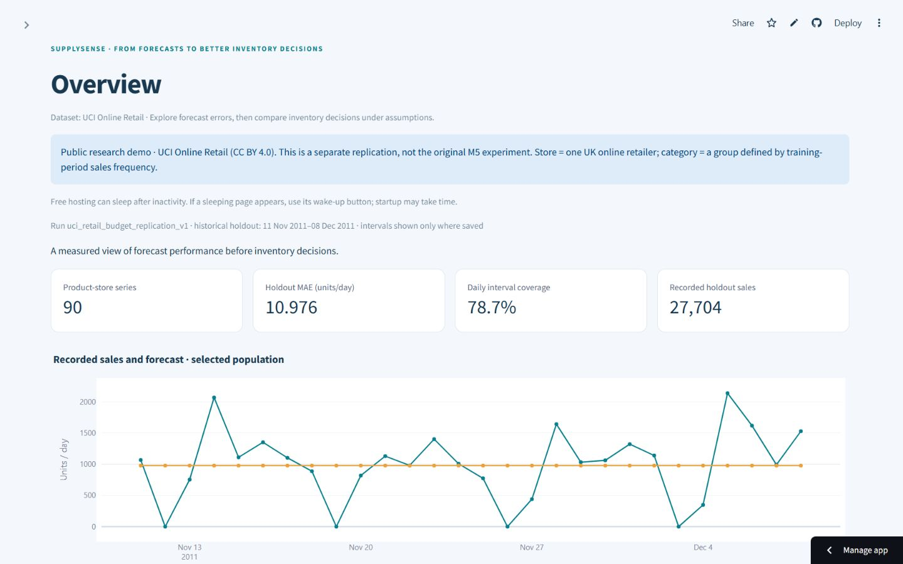
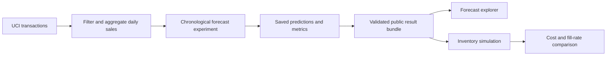

# SupplySense

Retail demand forecasting and simulated inventory planning, with model comparisons and interactive scenarios.

A forecast becomes an inventory decision when stock, cash and delivery delays enter the picture. SupplySense connects historical retail forecasts to an explicit replenishment simulation. Readers can compare methods, inspect product-level errors, change operating assumptions and see how simulated cost and fill rate respond.

The seven-page Streamlit app uses saved results for 90 UCI Online Retail products. Forecast comparisons include seasonal naive, a 28-day mean, Croston SBA and LightGBM. Scenario views make the relationship between prediction error and inventory outcomes inspectable.

[Open the public app](https://supplysense-adityahaa.streamlit.app/) · [Executed results](docs/INDEPENDENT_RESULTS.md) · [Technical report](docs/TECHNICAL_REPORT.md) · [Run locally](#run-on-windows)



## Contents

[Public demo](#public-demo) · [Walkthrough](#walkthrough) · [Forecast and inventory results](#forecast-and-inventory-results) · [Run on Windows](#run-on-windows) · [Architecture and reproduction](#architecture-and-reproduction) · [Factual portfolio bullets](#factual-portfolio-bullets) · [Technical documentation and attribution](#technical-documentation-and-attribution) · [Following a forecast into a stock decision](#following-a-forecast-into-a-stock-decision)

## Public demo

[Open SupplySense](https://supplysense-adityahaa.streamlit.app/) · [GitHub source](https://github.com/adityahaa/SupplySense). Hosted on free Streamlit Community Cloud with Python 3.12. The application and anonymous HTTP access were verified on 28 October 2026; see [verification details](docs/PUBLIC_VERIFICATION.md).

The public demo uses an independently evaluated, attributed **UCI Online Retail** subset. It is separate from the original local M5 experiment. Public artifacts contain 90 selected product series and saved predictions; visitors need no dataset upload, Python installation or GitHub sign-in. No model trains when a page refreshes.

Free Community Cloud apps can sleep after 12 hours without traffic. Anyone with access can use the wake-up button; cold starts can take time. Shared resources can throttle and no always-on performance is promised. No paid API, payment method or billing activation is required by this project. See [official hosting limits](https://docs.streamlit.io/deploy/streamlit-community-cloud/manage-your-app).

## Walkthrough

1. **Overview:** check the dataset and historical evaluation dates.
2. **Forecast explorer:** choose a product/model; inspect actuals, prediction bands and signed errors; download CSV.
3. **Model comparison:** compare measured MAE, RMSE, WAPE, bias and coverage. Coverage is not accuracy.
4. **Inventory planner:** change stock, cash, delays and costs to recalculate simulated orders, cost and fill rate.
5. **Scenario simulator:** stress demand or budget under explicit assumptions.
6. **Business impact:** compare forecast-error and simulated cost/service rankings under the same conditions.
7. **Research & methodology:** read the frozen protocol, all-origin findings, uncertainty and limitations.

On narrow screens, use the upper-left arrow to open navigation. Store means one UK online retailer; category means the training-defined demand-frequency group. All 90 selected products are intermittent under the frozen definition; no frequent-demand comparison is supported.

Wide research tables scroll horizontally on mobile. View the [captured mobile layout](docs/screenshots/public_mobile_overview.png). Screenshots show executed historical results, not mockups.

## Forecast and inventory results

Two nonoverlapping 28-day test origins yield 5,040 observations per method. Test MAE: LightGBM 9.992816, SBA 11.018639, 28-day mean 11.301219, seasonal naive 11.387500. LightGBM reduces MAE by 12.25% versus seasonal naive. **Validation selected the 28-day mean**, which remains the display default; the inspected test does not reselect it.

LightGBM interval coverage is 86.09%, below the nominal 90%; seasonal naive is 90.04% with wider bands. In 216 simulated comparisons, cost/service rankings vary across budgets, lead times, penalties and origins. Under the reference-budget/3-day-lead/5-CU-penalty cell, SBA has lowest cost at the first origin and LightGBM at the second. No universal winner or actual financial savings is claimed.

See [executed results](docs/INDEPENDENT_RESULTS.md), [literature positioning](docs/RESEARCH_EXTENSION.md), [protocol](docs/INDEPENDENT_PROTOCOL.json) and [data attribution](docs/PUBLIC_DATA_NOTICE.md). The research question has substantial prior overlap. This is a reproducible case study, not a novelty or publication-readiness claim. Both final windows are now inspected.

## Run on Windows

Download the repository ZIP and **Extract All**. Install 64-bit Python 3.12, enabling **Add Python to PATH**. In the extracted folder, double-click `setup_windows.bat` once; it creates `.venv`, installs requirements and starts the app. Later, double-click `start_windows.bat`. Open http://localhost:8501 and keep the terminal open. Press Ctrl+C to stop. No PowerShell activation or execution-policy change is needed.

Manual fallback from Command Prompt in that folder:

```bat
py -3.12 -m venv .venv
.venv\Scripts\python.exe -m pip install -r requirements.txt
.venv\Scripts\python.exe scripts\launch.py
```

## Architecture and reproduction

`app.py` handles navigation; `supplysense/ui.py` presentation; `pages.py` decision/research views; `artifacts.py` bounded checksum-validated loading; `forecast.py` scoring; `inventory.py` simulation; `research.py` matched comparisons. Application dependencies are NumPy, Pandas, Plotly and Streamlit. Optional training dependencies are separate.

The original M5 bundles remain unchanged locally and are excluded here pending redistribution verification; do not publish the complete local ZIP. This public release uses `results/public_results.zip` with selected aggregated CC BY 4.0 data. Raw invoices and customer identifiers are excluded. [Attribution and changes](docs/PUBLIC_DATA_NOTICE.md).

For replication install `requirements-dev.txt` and `openpyxl`, obtain the UCI download linked in the protocol, and run `python scripts/run_independent_retail.py --data PATH_TO_UCI_ZIP` in a fresh copy without `results/independent/`. Existing experiment directories are never overwritten. This fits ordinary local CPU compute; Colab is optional. Local complete checkpoints are retained separately from the compact public reports.

Run public core tests with `python -m pytest tests/test_core.py tests/test_research.py -q` after installing development dependencies. Full local verification and public-site smoke checks are documented in `docs/PUBLIC_VERIFICATION.md`.

Limits: one retailer, only intermittent products in the fixed sample, two final origins, censored positive-sales proxy, assumed costs, finite-horizon policies and daily residual bands without a dependence-aware coverage guarantee. Product-cluster bootstrap intervals do not capture cross-product shocks. Shared-budget simulations do not have independent-product confidence intervals. No causal effect, real savings or current-demand forecasts are claimed.

## Factual portfolio bullets

- Built and deployed a seven-page Streamlit application linking saved historical forecasts to configurable inventory simulations, with desktop/mobile browser checks and 11 core/research tests passing in the current review (earlier full verification is recorded separately).
- Evaluated four forecasting methods on 90 UCI retail products over two final chronological origins; measured LightGBM MAE of 9.992816 versus seasonal naive 11.387500, while reporting interval undercoverage.
- Executed 216 reproducible simulated inventory comparisons across budgets, replenishment delays and shortage penalties, preserving cases where forecast-error and operational rankings disagree.

## Technical documentation and attribution

See the [technical report](docs/TECHNICAL_REPORT.md) for architecture, evaluation scope, and current verification. Maintained in Aditya Hambire's repository; preserve existing Git history and third-party attribution. Repository ownership does not establish sole authorship.

Current checks and unresolved prerequisites: [verification record](docs/VERIFICATION.md).

## Following a forecast into a stock decision

Retail forecasts become useful when they help determine what to replenish under limited cash and delayed deliveries. The application makes that connection inspectable. A reader can start with the historical forecast comparison, choose a product and method, then vary inventory assumptions to see how the resulting ordering policy behaves.



### Forecast inputs and chronology

The independent retail script constructs a daily series after UK/positive-sales filtering, duplicate removal, and product-code checks. Missing product-days become zero recorded positive sales. Product eligibility and seeded selection use the training period. Direct LightGBM inputs describe the series, forecast horizon, target weekday and origin-known demand history. The seasonal, rolling-mean and SBA methods supply comparisons with simpler demand assumptions.

Validation, residual calibration and final testing occupy separate chronological windows. This matters because choosing the displayed model from final-test performance would change the evaluation question after observing the answer. The saved validation choice remains `mean_28`, while the result tables retain all four methods.

### Inventory mechanics

`supplysense/inventory.py::simulate` accepts one method's series/date predictions and explicit `Assumptions`. It validates finite, nonnegative values and rejects duplicate observations or mixed methods. The policy combines forecast demand with an optional fraction of the upper-band gap, schedules replenishment with a lead time, and tracks a shared purchasing budget. Costs include acquisition, holding, shortages and order fees. Fill rate expresses fulfilled proxy demand relative to total proxy demand.

The default interactive budget is 3,000 cost units. The recorded research grid uses a separate training-derived reference budget. A comparison is meaningful only when methods share observations and assumptions, which `research.py` checks before computing rankings. A lower forecasting error can coexist with a higher simulated cost because shortage penalties, delivery timing and cash allocation affect the decision.

### Reading the evidence

The pooled four-method results above come from the saved two-origin experiment. The compact public prediction file contains the final origin only. Its 2,520 rows per method support a narrower recomputation, documented in the verification record. Keeping those scopes explicit makes the dashboard reproducible without treating the compact artifact as the complete experiment archive.

The observed result is a functioning saved-results workflow and a historical comparison showing that forecasting and inventory rankings depend on different criteria. A useful next study would freeze a broader product sample and additional future windows before evaluating alternative allocation policies.

### Repository map

| Location | Responsibility |
|---|---|
| `app.py`, `supplysense/ui.py`, `supplysense/pages.py` | Navigation and interactive views |
| `supplysense/artifacts.py` | Size, checksum and schema validation |
| `supplysense/forecast.py` | Features, point metrics and interval metrics |
| `supplysense/inventory.py` | Replenishment policy and economic assumptions |
| `supplysense/research.py` | Matched comparisons and rankings |
| `scripts/run_independent_retail.py` | Independent retail experiment |
| `results/public_results.zip` | Compact public evidence |
| `tests/` | Forecast, simulation and comparison fixtures |
